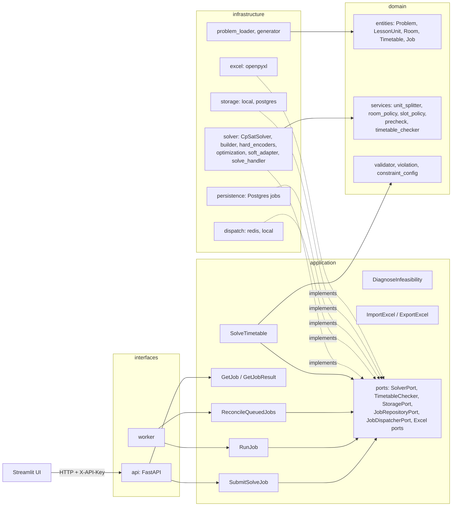

# Kiến trúc

Dự án theo Clean Architecture: phụ thuộc chỉ đi từ ngoài vào trong
(`interfaces` → `application` → `domain`; `infrastructure` hiện thực các port của `application`).



## Các lớp
| Lớp | Thư mục | Nội dung |
|---|---|---|
| domain | `src/timetable/domain` | Thực thể (`entities`), quy tắc nghiệp vụ thuần (`services`, `rules`), `Violation` và `Validator`. Không phụ thuộc framework. |
| application | `src/timetable/application` | Use case (`SolveTimetable`, `RunJob`, `DiagnoseInfeasibility`), DTO (`SolveOptions`, `SolveResult`) và các port (`typing.Protocol`). |
| infrastructure | `src/timetable/infrastructure` | Hiện thực port: CP-SAT (`solver`), Postgres (`persistence`), lưu trữ (`storage`), nạp dữ liệu (`problem_loader`). |
| interfaces | `src/timetable/interfaces` | API FastAPI và worker. |

## Luồng giải một bài toán
1. `problem_loader` đọc JSON và dựng `Problem` (tách môn thành các `LessonUnit` nếu cần).
2. `SolveTimetable.execute(problem, options)` gọi `SolverPort.solve`.
3. `CpSatSolver` gọi `build_model`: tạo biến bắt đầu `s[u,d,p,r]`, áp các encoder cứng, các
   encoder mềm và hàm mục tiêu (`SoftObjectiveApplier`), rồi giải bằng OR-Tools.
4. Kết quả (`SolveResult`: trạng thái, `Timetable`, `objective`, `cost_terms`) quay về use case.
5. Use case chạy `TimetableChecker` (mặc định `check_timetable`) và trả
   `SolveOutcome(result, violations)`; `outcome.ok` chỉ đúng khi có lịch và không vi phạm.

## Chạy theo job (API, hàng đợi, worker)

```
Client ──POST /solve──▶ API ──▶ SubmitSolveJob: lưu input vào storage, tạo job QUEUED (Postgres)
                                        │ dispatcher.dispatch(job_id)
              ┌─────────────────────────┴───────────────────────────┐
   JOB_DISPATCHER=redis                                   JOB_DISPATCHER=local
   LPUSH job_id vào Redis (QUEUE_NAME)                    API chạy `python -m ...worker.main`
   worker chạy vòng lặp BRPOP                             như tiến trình con, kèm JOB_ID=<id>
              └─────────────────────────┬───────────────────────────┘
                                        ▼
        RunJob: QUEUED → RUNNING → handler (solve_handler) → ghi result.json → SUCCEEDED / FAILED
Client ──GET /jobs/{id}, /jobs/{id}/result──▶ API (GetJob, GetJobResult)
```

- **Dispatcher** (`infrastructure/dispatch`): `redis` là mặc định, dùng khi có Redis và worker riêng
  (docker compose). `local` dành cho nơi không có Redis (Render miễn phí): mỗi job là một tiến trình
  con của API, chạy ở chế độ một job (`JOB_ID`, hàm `run_single_job`).
- **Storage** (`STORAGE_BACKEND`): `local` (thư mục `STORAGE_DIR`) hoặc `postgres` (bảng `blobs`) khi
  không có ổ đĩa bền. API và worker phải dùng cùng cấu hình.
- **Handler** (`solve_handler.py`): đọc JSON, kiểm tra `constraint_config_version`, dựng
  `build_default_solver`, giải, chạy `check_timetable`; lịch vi phạm cứng làm job `FAILED`.
  Giới hạn tài nguyên bằng `SOLVER_MAX_WORKERS` và `SOLVER_MAX_TIME_S` (giá trị yêu cầu vượt mức này
  bị cắt xuống).
- **Heartbeat**: bảng job có cột `heartbeat_at` và repository có `touch_heartbeat`,
  `list_stale_running_jobs`, `fail_stale_running_job`. **Hiện chưa có tiến trình nào gọi các hàm này**
  (worker không cập nhật heartbeat, chưa có bước đánh `FAILED` cho job treo), nên job `RUNNING` bị
  kẹt vẫn kẹt mãi. Xem `docs/known-issues.md`.
- **Reconcile**: `ReconcileQueuedJobs` quét định kỳ các job `QUEUED` có thể bị mất khỏi hàng đợi
  (ví dụ Redis khởi động lại) và đẩy lại.
- **Xác thực**: mọi endpoint trừ `/health` yêu cầu header `X-API-Key` khớp biến `API_KEY`
  (`interfaces/api/security.py`). UI và `scripts/smoke_test.py` phải gửi header này.

### Biến môi trường

| Biến | Dùng ở | Ý nghĩa |
|---|---|---|
| `DATABASE_URL` | API, worker | Postgres lưu job (và blob nếu `STORAGE_BACKEND=postgres`) |
| `REDIS_URL`, `QUEUE_NAME` | API, worker | Hàng đợi khi `JOB_DISPATCHER=redis` |
| `JOB_DISPATCHER` | API | `redis` (mặc định) hoặc `local` |
| `STORAGE_BACKEND`, `STORAGE_DIR` | API, worker | `local` hoặc `postgres` |
| `API_KEY` | API, UI | Khóa xác thực `X-API-Key` |
| `API_URL` | UI | Địa chỉ API |
| `SOLVER_MAX_WORKERS`, `SOLVER_MAX_TIME_S` | worker | Trần số luồng và thời gian giải |

## Hiệu năng và quy mô
CP-SAT chạy nhiều luồng nên kết quả không lặp lại chính xác giữa các lần. Số đo mới nhất
(`docs/reports/scale_benchmark.md`): 30 lớp giải tối ưu trong khoảng 12 s, 50 lớp có nghiệm
trong 60 s nhưng chưa tối ưu. Giải hai pha và `AddHint` không cải thiện. Các encoder tối ưu xem
`docs/encoders.md`.

## Excel và giao diện
`ImportExcel` (`OpenpyxlExcelImporter`) đọc file Excel (sheet Phòng, Giáo viên, Lớp, Môn) thành
payload `solve`; `ExportExcel` ghi lịch ra Excel. Streamlit (`interfaces/ui`, hiện mới có tải file, gửi job và xem trạng thái) không gọi use case
trực tiếp mà đi qua `SolverApiClient` gọi API, nên UI và solver triển khai độc lập.

## Quy tắc phụ thuộc giữa các tầng
| Tầng | Được import |
|---|---|
| `domain` | chỉ `domain` |
| `application` | `domain`, `application` |
| `infrastructure` | `domain`, `application`, `infrastructure` |
| `interfaces` | mọi tầng (nơi lắp ráp: worker và API tạo các adapter) |

Về thư viện ngoài:
- `domain` không dùng thư viện framework (`ortools`, `sqlalchemy`, `fastapi`, `pydantic`, `psycopg`,
  `alembic`, `openpyxl`, `dotenv`, `streamlit`, `uvicorn`, `starlette`).
- `application` không dùng framework, **trừ `pydantic`** (được phép để mô tả DTO).
- `infrastructure` và `interfaces` dùng thư viện tự do.

`tests/unit/test_architecture.py` kiểm tra các quy tắc này bằng cách phân tích cú pháp mọi file
trong `src/timetable` (tính cả import nằm trong hàm hoặc sau `TYPE_CHECKING`, và import tương đối). Chạy
trong CI cùng `pytest`; vi phạm làm test đỏ và in ra file, dòng và import vi phạm. Không dùng
`import-linter` để khỏi thêm thư viện dev và bước CI.

Ngoại lệ đã ghi nhận:
- `JobRepositoryPort` nằm ở `domain/ports/job_repository.py`, trong khi các port khác nằm ở
  `application/ports/`. Giữ nguyên vì hợp lệ về phụ thuộc (domain không import tầng ngoài). Khi thêm
  port mới, ưu tiên đặt ở `application/ports/`.

## Kiểm tra lịch: dùng module nào

Repo có bốn chỗ kiểm tra lịch, mỗi chỗ phục vụ một việc:

| Module | Dùng để | Ghi chú |
|---|---|---|
| `domain/services/timetable_checker.py` (`check_timetable`) | Bộ kiểm tra độc lập sau khi giải, dùng trong `SolveTimetable` và worker. Lịch vi phạm cứng thì job `FAILED`, không lưu kết quả | Làm việc trên `Problem` + `Timetable` |
| `domain/validator.py` (`Validator`) | Validator tổng quát của P5, nhận lịch dạng dict hoặc entity, `validate(timetable, problem=None)` | Chữ ký này có test, không đổi thứ tự tham số |
| `domain/services/validation_report.py` (`build_report`) | Báo cáo vi phạm cứng và mềm kèm tóm tắt cho E2E Excel | Của P5 (task 10) |
| `domain/validation_report.py` (`validate_soft`, `summarize_validation`) | Tính điểm phạt mềm từ `reference_cost`, dùng trong `scripts/run_e2e_soft_check.py` | Của P2. Trùng tên với module ở dòng trên, nên gộp hoặc đổi tên khi dọn code |

Khi thêm việc kiểm tra mới, mở rộng module sẵn có thay vì tạo bản thứ tư.

## Quy ước
- Thư mục `tests/` không có `__init__.py`: mỗi module test và helper phải có tên duy nhất
  (ví dụ `solver_helpers.py`), nếu không pytest báo trùng tên module.
- `mypy --strict` chỉ kiểm tra `src`. Dùng API snake_case của OR-Tools
  (`new_bool_var`, `add_exactly_one`, `solve`...).
- Mỗi thay đổi đi qua một nhánh `feature/...` và PR vào `main`; CI chạy ruff, ruff format, mypy,
  pytest.
