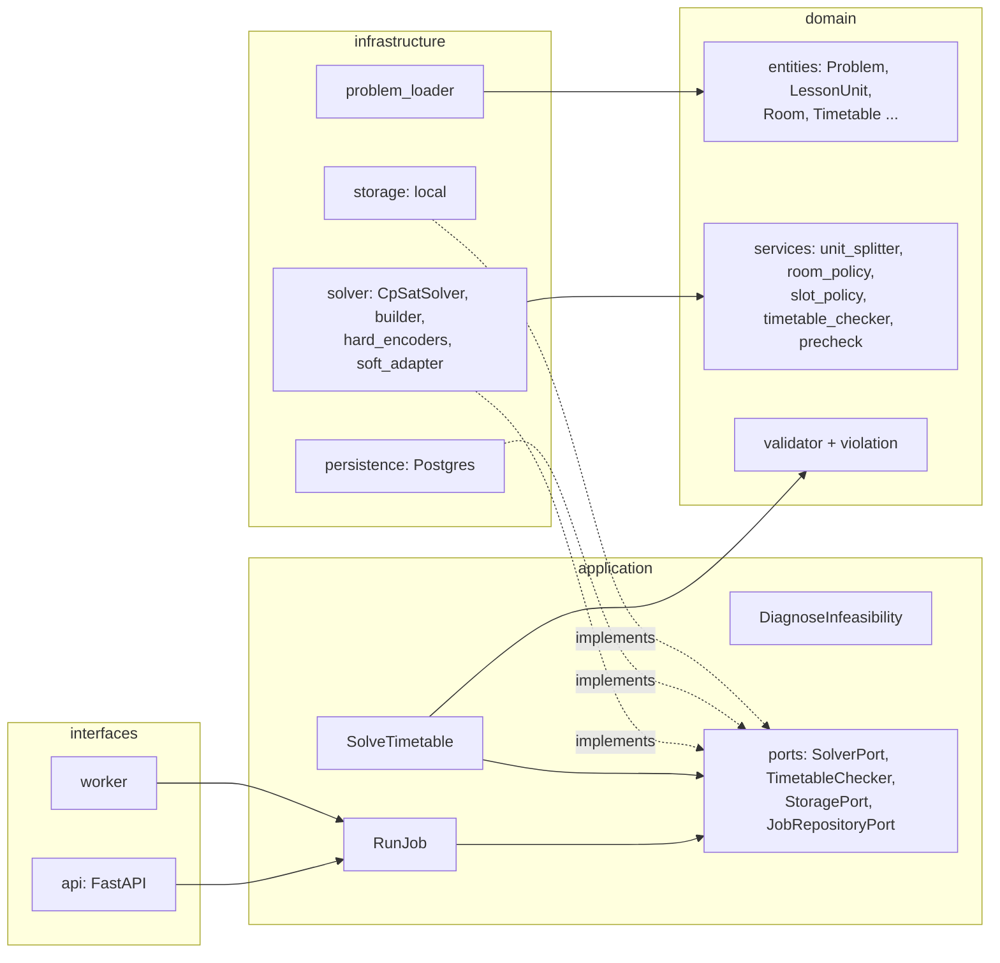

# Kiến trúc

Dự án theo Clean Architecture: phụ thuộc chỉ đi từ ngoài vào trong
(`interfaces` → `application` → `domain`; `infrastructure` hiện thực các port của `application`).

## Các lớp
| Lớp | Thư mục | Nội dung |
|---|---|---|
| domain | `src/timetable/domain` | Thực thể (`entities`), quy tắc nghiệp vụ thuần (`services`, `rules`), `Violation` và `Validator`. Không phụ thuộc framework. |
| application | `src/timetable/application` | Use case (`SolveTimetable`, `RunJob`, `DiagnoseInfeasibility`), DTO (`SolveOptions`, `SolveResult`) và các port (`typing.Protocol`). |
| infrastructure | `src/timetable/infrastructure` | Hiện thực port: CP-SAT (`solver`), Postgres (`persistence`), lưu trữ (`storage`), nạp dữ liệu (`problem_loader`). |
| interfaces | `src/timetable/interfaces` | API FastAPI và worker. |

## Luồng giải một bài toán
1. `problem_loader` đọc JSON và dựng `Problem` (tách môn thành các `LessonUnit` nếu cần).
2. `SolveTimetable.execute(problem, options)` gọi `SolverPort.solve`.
3. `CpSatSolver` gọi `build_model`: tạo biến bắt đầu `s[u,d,p,r]`, áp các encoder cứng, các
   encoder mềm và hàm mục tiêu (`SoftObjectiveApplier`), rồi giải bằng OR-Tools.
4. Kết quả (`SolveResult`: trạng thái, `Timetable`, `objective`, `cost_terms`) quay về use case.
5. Use case chạy `TimetableChecker` (mặc định `check_timetable`) và trả
   `SolveOutcome(result, violations)`; `outcome.ok` chỉ đúng khi có lịch và không vi phạm.

## Chạy theo job (worker)
`RunJob` đọc đầu vào từ storage, gọi một handler `bytes -> bytes`, ghi `result.json` và cập nhật
trạng thái job trong Postgres. Handler hiện tại là solver giả (`infrastructure/solver/fake.py`);
nối `SolveTimetable` vào worker là một thay đổi riêng, cần thống nhất định dạng `result.json`,
cách đánh dấu job vô nghiệm và cấu hình CPU của container worker.

## Quy tắc phụ thuộc giữa các tầng
| Tầng | Được import |
|---|---|
| `domain` | chỉ `domain` |
| `application` | `domain`, `application` |
| `infrastructure` | `domain`, `application`, `infrastructure` |
| `interfaces` | mọi tầng (nơi lắp ráp: worker và API tạo các adapter) |

Về thư viện ngoài:
- `domain` không dùng thư viện framework (`ortools`, `sqlalchemy`, `fastapi`, `pydantic`, `psycopg`,
  `alembic`, `openpyxl`, `dotenv`, `streamlit`, `uvicorn`, `starlette`).
- `application` không dùng framework, **trừ `pydantic`** (được phép để mô tả DTO).
- `infrastructure` và `interfaces` dùng thư viện tự do.

`tests/unit/test_architecture.py` kiểm tra các quy tắc này bằng cách phân tích cú pháp mọi file
trong `src/timetable` (tính cả import nằm trong hàm hoặc sau `TYPE_CHECKING`, và import tương đối). Chạy
trong CI cùng `pytest`; vi phạm làm test đỏ và in ra file, dòng và import vi phạm. Không dùng
`import-linter` để khỏi thêm thư viện dev và bước CI.

Ngoại lệ đã ghi nhận:
- `JobRepositoryPort` nằm ở `domain/ports/job_repository.py`, trong khi các port khác nằm ở
  `application/ports/`. Giữ nguyên vì hợp lệ về phụ thuộc (domain không import tầng ngoài). Khi thêm
  port mới, ưu tiên đặt ở `application/ports/`.

## Kiểm tra lịch: dùng module nào

Repo có bốn chỗ kiểm tra lịch, mỗi chỗ phục vụ một việc:

| Module | Dùng để | Ghi chú |
|---|---|---|
| `domain/services/timetable_checker.py` (`check_timetable`) | Bộ kiểm tra độc lập sau khi giải, dùng trong `SolveTimetable` và worker. Lịch vi phạm cứng thì job `FAILED`, không lưu kết quả | Làm việc trên `Problem` + `Timetable` |
| `domain/validator.py` (`Validator`) | Validator tổng quát của P5, nhận lịch dạng dict hoặc entity, `validate(timetable, problem=None)` | Chữ ký này có test, không đổi thứ tự tham số |
| `domain/services/validation_report.py` (`build_report`) | Báo cáo vi phạm cứng và mềm kèm tóm tắt cho E2E Excel | Của P5 (task 10) |
| `domain/validation_report.py` (`validate_soft`, `summarize_validation`) | Tính điểm phạt mềm từ `reference_cost`, dùng trong `scripts/run_e2e_soft_check.py` | Của P2. Trùng tên với module ở dòng trên, nên gộp hoặc đổi tên khi dọn code |

Khi thêm việc kiểm tra mới, mở rộng module sẵn có thay vì tạo bản thứ tư.

## Quy ước
- Thư mục `tests/` không có `__init__.py`: mỗi module test và helper phải có tên duy nhất
  (ví dụ `solver_helpers.py`), nếu không pytest báo trùng tên module.
- `mypy --strict` chỉ kiểm tra `src`. Dùng API snake_case của OR-Tools
  (`new_bool_var`, `add_exactly_one`, `solve`...).
- Mỗi thay đổi đi qua một nhánh `feature/...` và PR vào `main`; CI chạy ruff, ruff format, mypy,
  pytest.
